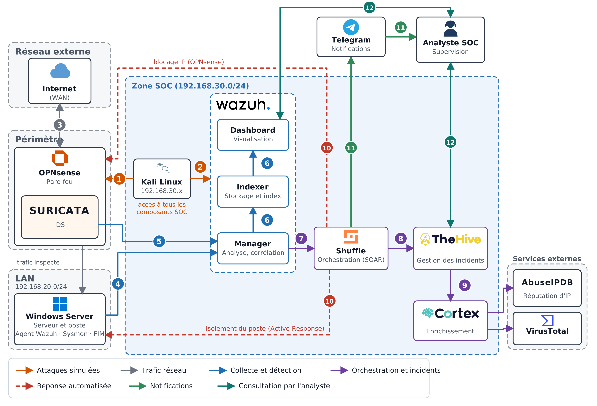

# Plateforme SOC/SIEM open source

Solution SOC complète, déployable en laboratoire (Oracle VirtualBox) ou sur des serveurs :
détection, gestion d'incidents, enrichissement et réponse automatisée.

## Outils utilisés

| Brique | Rôle |
|---|---|
| OPNsense + Suricata | Pare-feu, segmentation réseau, détection d'intrusion (IDS) |
| Wazuh | SIEM : collecte, corrélation et alertes |
| Shuffle | SOAR : orchestration et automatisation de la réponse |
| TheHive | Gestion des incidents |
| Cortex | Analyse et enrichissement des observables (AbuseIPDB, VirusTotal) |

## Contenu du dépôt

- [`docs/architecture.md`](docs/architecture.md) : machines virtuelles, ressources, réseaux et flux
- Les configurations de chaque outil et les intégrations entre eux seront ajoutées brique par brique.

## Important

Ce dépôt ne contient aucun secret. Les clés API, mots de passe et tokens sont remplacés par
des valeurs `CHANGE_ME` : renseigne les tiens avant tout déploiement.

## État

En construction.
