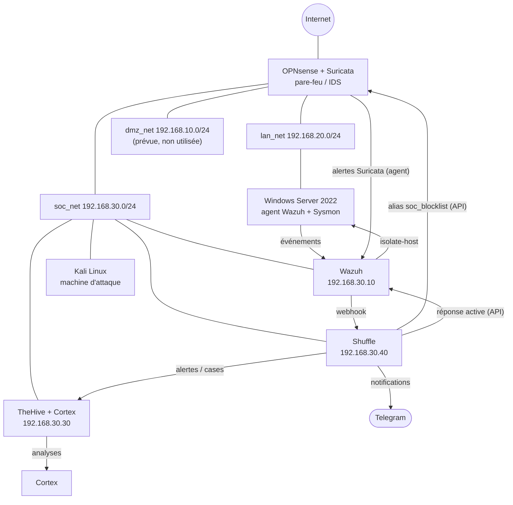

# SOC / SIEM platform — laboratoire de détection et de réponse automatisée

Plateforme SOC complète construite dans un laboratoire VirtualBox : détection (Wazuh, Suricata),
gestion des incidents (TheHive), enrichissement (Cortex) et réponse automatisée (Shuffle) avec blocage
au pare-feu (OPNsense) et isolation d'hôte. Projet réalisé dans le cadre d'un projet de fin d'études.

Ce dépôt contient **les configurations et la documentation de chaque brique**, sans aucun secret,
pour pouvoir reconstruire le laboratoire.

## Architecture

| Machine | Rôle | Système | Réseau |
|---|---|---|---|
| OPNsense | Routage, filtrage, IDS Suricata | OPNsense 26.1.6 | WAN (NAT), lan_net, dmz_net, soc_net |
| Wazuh | SIEM : collecte, analyse, réponse active | Ubuntu Server 24.04 | soc_net (`192.168.30.10`) |
| TheHive + Cortex | Gestion des incidents et analyse des observables | Ubuntu Server 24.04 | soc_net (`192.168.30.30`) |
| Shuffle | Orchestration SOAR | Ubuntu Server 24.04 | soc_net (`192.168.30.40`) |
| Windows Server | Cible supervisée | Windows Server 2022 | lan_net |
| Kali Linux | Machine d'attaque (tests) | Kali 2026.1 | lan_net, soc_net |

Hôte : Windows 10, VirtualBox 7.2.10, 32 Go de RAM.

## Chaîne de traitement d'une alerte

1. **Détection** : Wazuh (agent Windows avec Sysmon, FIM, VirusTotal) et Suricata sur OPNsense.
2. **Transmission** : le manager Wazuh envoie les alertes de sévérité élevée au webhook de Shuffle.
3. **Qualification** : déduplication, puis classification (ransomware, IP, hash, malware déjà confirmé, autre).
4. **Incident** : création de l'alerte et du case dans TheHive, avec un modèle dédié pour le ransomware.
5. **Enrichissement** : analyseurs Cortex (AbuseIPDB pour les IP, VirusTotal pour les hash).
6. **Réponse** : blocage de l'IP malveillante sur OPNsense, ou isolation de l'hôte Windows pour un ransomware.
7. **Notification** : message Telegram à l'analyste.

## Contenu du dépôt

| Dossier | Contenu |
|---|---|
| [`opnsense/`](opnsense/) | Configuration d'OPNsense et de Suricata |
| [`wazuh/`](wazuh/) | Manager (`ossec.conf`, règles locales), agent Windows, scripts de réponse active d'isolation |
| [`thehive/`](thehive/) | Pile Docker TheHive 5 (Cassandra, Elasticsearch, Nginx) et configuration |
| [`cortex/`](cortex/) | Cortex en mode autonome avec son Elasticsearch dédié |
| [`shuffle/`](shuffle/) | Pile Docker Shuffle et export du workflow `soc_automation` |

Chaque dossier a son propre `README.md` avec les étapes de déploiement.

## Ordre de déploiement

1. **OPNsense** et segmentation réseau (`opnsense/`).
2. **Wazuh** : manager, agent Windows, Sysmon, FIM, VirusTotal, intégration Suricata (`wazuh/`).
3. **TheHive** (`thehive/`), puis **Cortex** (`cortex/`) et leur association.
4. **Shuffle** : déploiement, import du workflow et connexions (`shuffle/`).
5. **Réponse active** : scripts d'isolation sur l'agent Windows (`wazuh/agent-windows/active-response/`).
6. Webhook Wazuh vers Shuffle : renseigner `hook_url` dans `wazuh/manager/ossec.conf`.

## Scénarios de test validés

| Scénario | Détection | Réponse |
|---|---|---|
| Force brute (Hydra) | Échecs de connexion Wazuh | Case TheHive, analyse AbuseIPDB, blocage sur OPNsense |
| Scan de ports (Nmap) | Alertes Suricata dans Wazuh | Case TheHive, enrichissement de l'IP |
| Ransomware | Règle de corrélation Wazuh | Case « Ransomware Response », isolation de l'hôte, notification |
| Fichier malveillant | Intégration VirusTotal, suppression automatique | Notification sans analyse supplémentaire |
| Fichier légitime (faux positif) | Analyse VirusTotal via Cortex | Notification « fichier ok », aucune action |

## Sécurité du dépôt

Aucun secret n'est publié : mots de passe, clés API, jetons, fichiers `.env`, `secret.conf`, certificats.
Chaque brique fournit des modèles (`.env.example`, `*.template`) avec des valeurs `YOUR_...` ou `CHANGEME`.
Les adresses IP sont celles du laboratoire (réseaux privés). Voir le `.gitignore`.

## Limites connues

- L'export du workflow Shuffle est nettoyé : les URL, clés et `chat_id` sont vides, et le corps des nœuds
  TheHive et Telegram est à réécrire après l'import (voir `shuffle/README.md`).
- Le montage de `/var/run/docker.sock` (Cortex, Shuffle) est acceptable en laboratoire, à restreindre en production.
- La zone DMZ est déclarée dans OPNsense mais n'est pas exploitée.

## Auteur

Marwen Benkemla — projet de fin d'études (SOC / SIEM).
