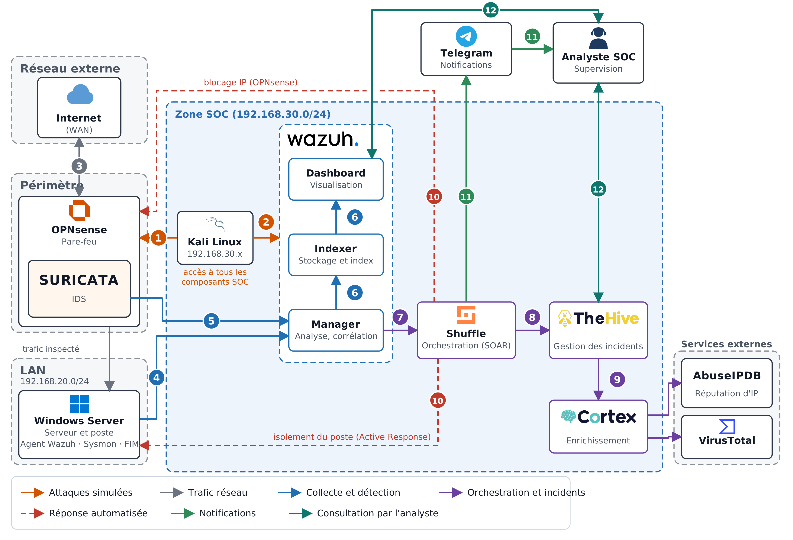
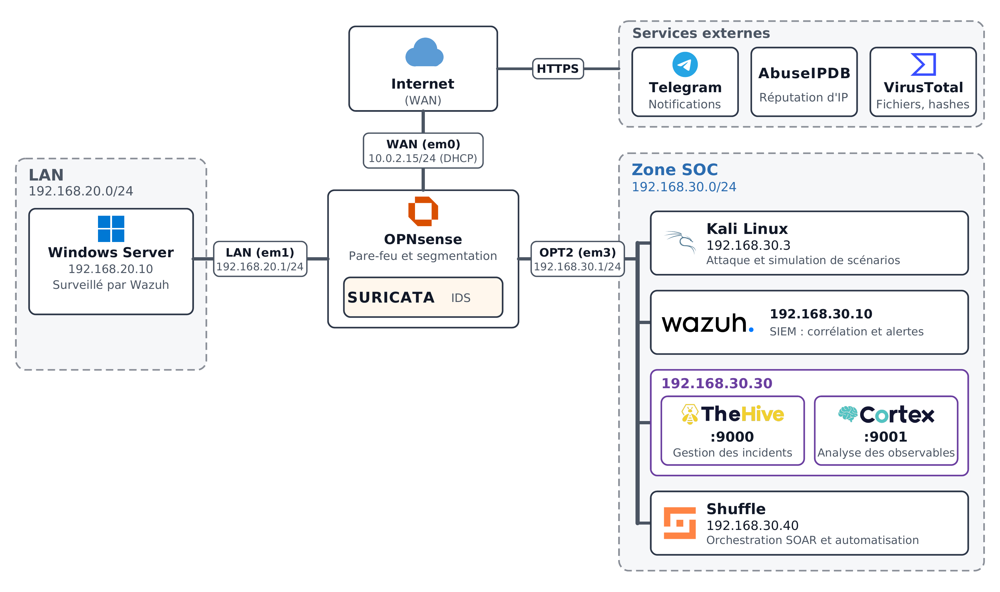

# Architecture du laboratoire SOC

Plateforme SOC/SIEM complète déployée sous Oracle VirtualBox 7.2.10 :
détection (Suricata, Wazuh), gestion d'incidents (TheHive), analyse (Cortex)
et automatisation de la réponse (Shuffle).

## Vue d'ensemble

La chaîne de traitement, numérotée comme sur le schéma :

| Étape | Description |
|---|---|
| 1 | Kali Linux lance les attaques simulées vers l'infrastructure (traversée d'OPNsense) |
| 2 | Kali accède à l'ensemble des composants SOC |
| 3 | OPNsense assure la sortie vers Internet (WAN) |
| 4 | L'agent Wazuh, Sysmon et le FIM du Windows Server remontent leurs événements au Wazuh Manager |
| 5 | Suricata (IDS sur OPNsense) envoie ses alertes au Wazuh Manager |
| 6 | Le Manager analyse et corrèle, l'Indexer stocke, le Dashboard visualise |
| 7 | Wazuh envoie les alertes sévères à Shuffle (webhook) |
| 8 | Shuffle crée l'alerte, les observables et le case dans TheHive |
| 9 | TheHive déclenche Cortex, qui enrichit via AbuseIPDB et VirusTotal |
| 10 | Réponse automatisée : blocage de l'IP sur OPNsense et isolement du poste (Active Response) |
| 11 | Notification Telegram à l'analyste SOC |
| 12 | L'analyste consulte le Dashboard Wazuh et TheHive |

## Schéma réseau

## Machines virtuelles

| VM | OS | RAM | vCPU | Disque | Réseau |
|---|---|---|---|---|---|
| Wazuh | Ubuntu Server 24.04.4 LTS | 4 Go | 3 | 50 Go | soc_net |
| TheHive + Cortex | Ubuntu Server 24.04.4 LTS | 6 Go (partagés) | 2 | 40 Go | soc_net |
| Shuffle | Ubuntu Server 24.04.4 LTS | 4 Go | 2 | 40 Go | soc_net |
| Windows Server | Windows Server 2022 64 bits | 4 Go | 2 | 50 Go | lan_net |
| OPNsense | OPNsense 26.1.6 | 2 Go | 2 | 40 Go | NAT, lan_net, dmz_net, soc_net |
| Kali Linux | Kali Linux 2026.1 (amd64) | 4 Go | 2 | 20 Go | soc_net |

Total alloué : environ 24 Go de RAM, 13 vCPU, 240 Go de disque (maximum, disques dynamiques).

**Prérequis recommandés pour l'hôte** : 32 Go de RAM, 8 cœurs ou plus, 250 Go libres,
SSD fortement conseillé (Elasticsearch et Cassandra sont gourmands en I/O).

## Segmentation réseau

| Zone | Réseau VirtualBox | Interface OPNsense | Sous-réseau | Contenu |
|---|---|---|---|---|
| WAN | NAT | em0 | 10.0.2.0/24 (DHCP) | Sortie Internet, services externes en HTTPS |
| LAN | lan_net | em1 | 192.168.20.0/24 | Systèmes supervisés (Windows Server) |
| SOC | soc_net | em3 (OPT2) | 192.168.30.0/24 | Kali, Wazuh, TheHive, Cortex, Shuffle |
| DMZ | dmz_net | em2 (OPT1) | 192.168.10.0/24 | Déclarée, réservée à un usage futur (non utilisée) |

Ordre des adaptateurs VirtualBox sur la VM OPNsense (il doit correspondre à l'ordre em0 à em3) :

| Adaptateur | Mode | Interface FreeBSD |
|---|---|---|
| 1 | NAT | em0 (WAN) |
| 2 | Réseau interne `lan_net` | em1 (LAN) |
| 3 | Réseau interne `dmz_net` | em2 (OPT1) |
| 4 | Réseau interne `soc_net` | em3 (OPT2) |

## Adressage

| Machine | Adresse | Zone |
|---|---|---|
| OPNsense | 10.0.2.15 (DHCP) / 192.168.20.1 / 192.168.30.1 | WAN / LAN / SOC |
| Windows Server | 192.168.20.10 | LAN |
| Kali Linux | 192.168.30.3 | SOC |
| Wazuh | 192.168.30.10 | SOC |
| TheHive (:9000) + Cortex (:9001) | 192.168.30.30 | SOC |
| Shuffle | 192.168.30.40 | SOC |

## Flux principaux

Ports par défaut, à adapter si tu les as modifiés.

| Source | Destination | Port | Usage |
|---|---|---|---|
| Agents (Windows, OPNsense) | Wazuh | 1514, 1515 | Collecte et enrôlement des agents |
| Wazuh | Shuffle | 3001 | Webhook d'alertes |
| Shuffle | TheHive | 9000 | Création d'alertes, observables, cases |
| TheHive | Cortex | 9001 | Lancement des analyzers |
| Shuffle | Wazuh API | 55000 | Authentification et actions |
| Shuffle | OPNsense API | 443 | Alias `soc_blocklist` |
| Cortex, Shuffle | Internet | 443 | AbuseIPDB, VirusTotal, Telegram |
